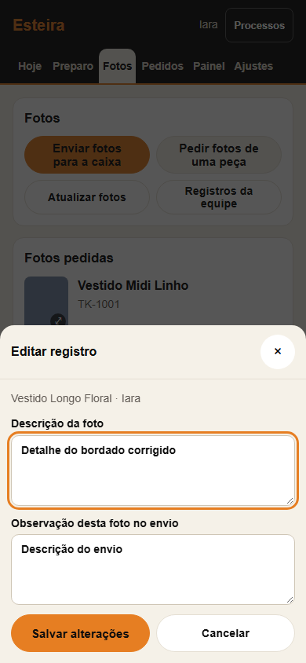
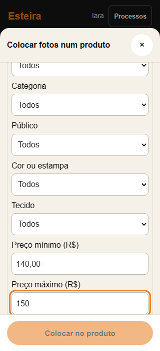
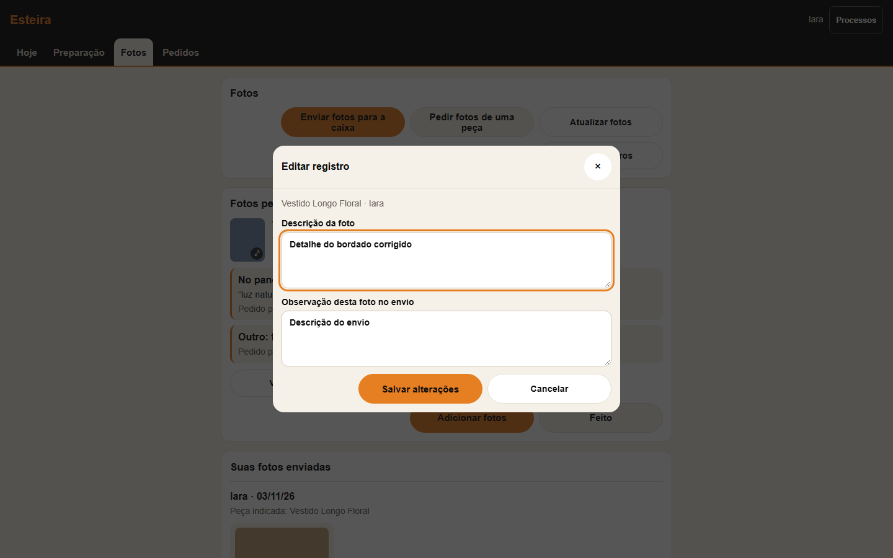

# Esteira: continuidade em Fotos, correções e faixa de preço

## Tarefa humana e contrato

Quem trabalha com fotos precisa conseguir olhar, escolher, escrever e associar imagens sem perder o contexto quando chegam dados novos. Funcionários corrigem os próprios textos; Admin total corrige os de qualquer pessoa. Os seletores de produto começam em Ativas, permitem mudar a situação e combinar uma faixa de preço de cadastro com os demais filtros.

Referência: a aba Fotos, o seletor de produto e as imagens fornecidas pelo proprietário. Preservados os componentes da própria Esteira: botões de44–48px, folhas móveis/desktop, Inter/Poppins, fundo areia, bordas discretas, foco laranja e TKCamadas. Sem tema, biblioteca visual ou reorganização global.

## Mudanças

- Fotos não é reconstruída pelo timer de30s, retorno à janela, retorno da rede ou conclusão de processos em segundo plano. Os processos continuam; o status informa a confirmação. O botão Atualizar fotos permite reler a lista quando a pessoa decidir. Atualizações das demais abas permanecem.
- Uma resposta lenta de ação anterior não reconstrói Fotos após nova interação. Digitar enquanto uma observação é salva mantém o editor aberto com o texto novo e a versão confirmada, permitindo salvar novamente sem perder o rascunho.
- Meus registros / Registros da equipe em Hoje e Fotos: fotos enviadas, pedidos de fotos, conferências e tarefas concluídas, com paginação. Edita descrições e observações; preserva arquivos, autoria, datas, resultados de estoque e conclusões. Pedidos preservam suas opções e instruções. A foto também tem Editar descrição.
- Autorização no Worker pela autoria original; somente gerir_acessos permite editar registros de outras pessoas. Tarefas concluídas também recebem proteção na rota antiga. Versão do texto é conferida no salvamento, com recusa de conflito sem perder o rascunho. A tabela aditiva est_registro_edicao guarda antes/depois, autor e data da correção. O editor fica aberto até confirmar sucesso; erro restaura o foco quando necessário. Troca de conta fecha suas folhas.
- Os seletores de Preparação e de associação/solicitação de fotos deixam de iniciar em Todas; todos usam Ativas como padrão. As situações disponíveis continuam selecionáveis dentro do escopo da lista.
- Faixa de preço na função compartilhada de busca da Esteira: mínimo/máximo em reais, vírgula aceita, limites inclusivos, sem limite quando vazio. Peças sem preço continuam visíveis sem faixa e ficam fora de uma faixa numérica. Faixa invertida/inválida mostra mensagem e aria-invalid. Outros consumidores de TKProdutosBusca mantêm o comportamento anterior.
- Resultados da Esteira mostram o preço normal usado na faixa e o preço à vista, evitando aparente divergência entre filtro e valor mostrado.

## Validação

- Worker com SQLite real e provedores simulados: worker_esteira219, worker_esteira_fotos68. Abrange autorização por autoria, admin, paginação, conflito, preservação dos fatos e histórico apenas de edições aceitas. Não escreve em contas reais.
- Regressão esteira_fotos_ui:130 verificações aprovadas; associação, uploads simulados, retomada, seleção, cadastro e descarte/desfazer preservados. A expectativa de reconstrução automática após conclusão foi substituída pela atualização explícita solicitada.
- Nova jornada esteira_continuidade_edicao_ui:320×700,390×844,412×915 e1440×900, administrador e equipe. Avança o relógio além de30s, dispara online/visibilitychange e confere nós/seleção/rascunho preservados. Inclui edição, erro409, teclado/Escape, troca de conta e filtros de situação/preço. Sem erro JS ou rolagem horizontal. Botões e campos críticos medidos em pelo menos44px; o último campo de preço permanece alcançável acima do rodapé da folha.
- Texto130% e altura reduzida para470px no celular /600px no desktop: salvar continua alcançável por rolagem. É simulação de área reduzida, não comprovação de teclado ou APK físico.
- produtos_busca_esteira_ia: quatro viewports aprovadas, incluindo ordem, facetas e seletor de galeria da IA. Nenhuma geração paga ou envio real executado.
- Graphify start/query (`esteira fotos abrirAba desenharCaixa buscaCatalogo`) e ensure tentados: extração excedeu180s. Fontes e testes usados diretamente; nenhum cache antigo tratado como prova.

## Revisão visual

Capturas examinadas: edição390/1440 e faixa de preço320/1440; botões, rótulos, campos, contexto e rolagem preservam a linguagem existente. A folha de edição mantém título e fechamento visíveis, conteúdo rolável e ações alcançáveis. Sem colisão conhecida ou perda automática de contexto nos cenários validados.

Resultado: **APROVADO COM LIMITAÇÃO** — navegador e serviços simulados; aparelho Android físico e provedores reais não foram usados nos testes. Nenhum código nativo Android foi alterado.

