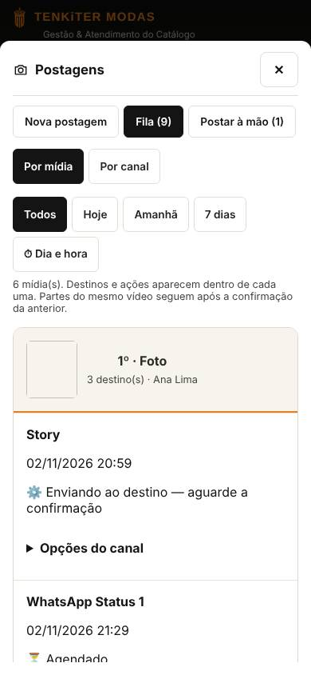
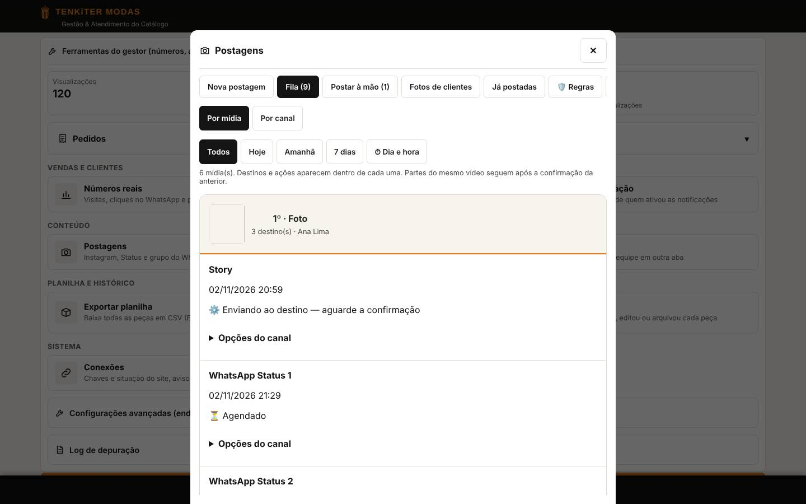
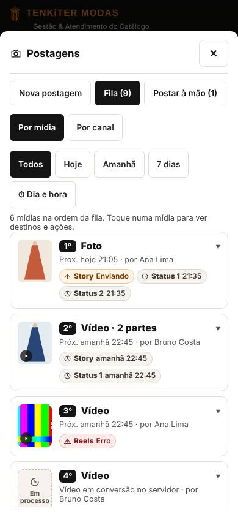
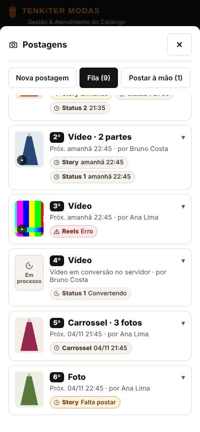
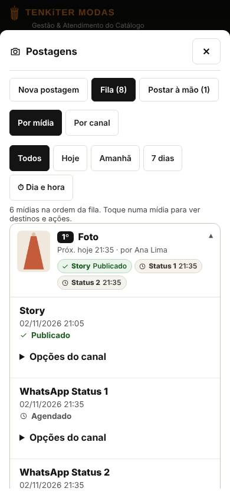
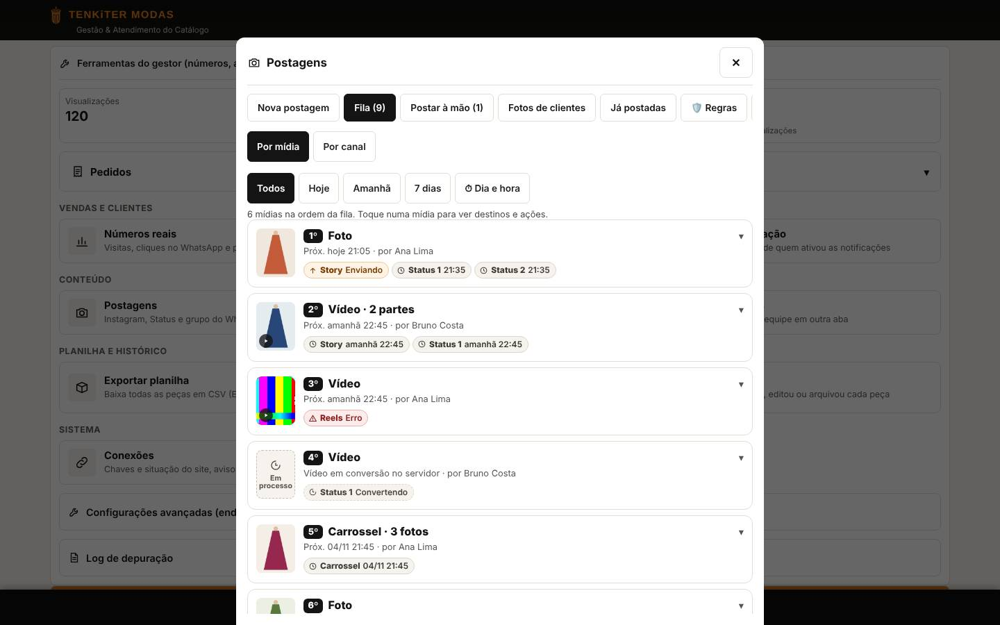
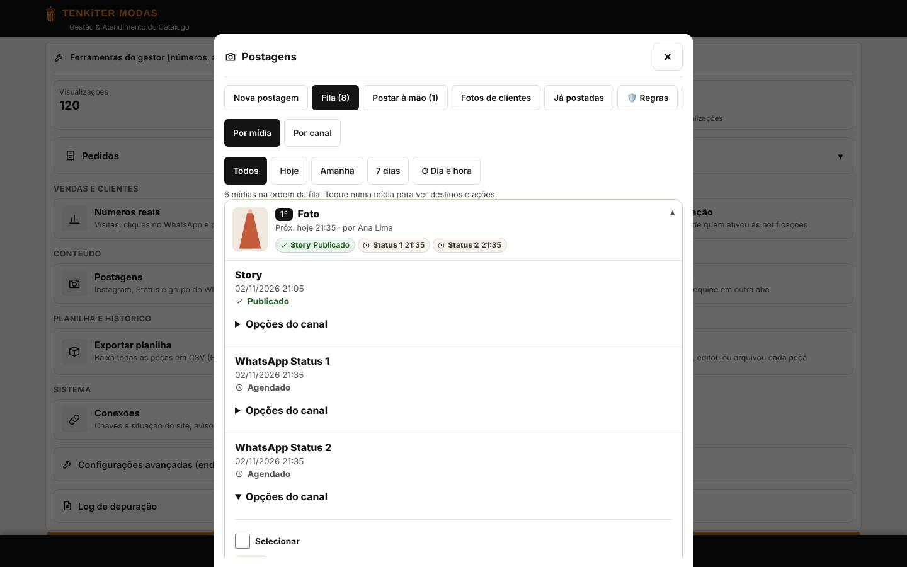

# Postagens → Fila → Por mídia: cards recolhidos e miniatura real (v7.48.2)

Revisão pela skill `tenkiter-estetica-humana`. Rota: `admin.html` → Gestão → Postagens → aba **Fila** → **Por mídia**.

## Tarefa humana

A equipe abre a fila para **conferir o que vai sair, em que ordem e em quais destinos, e agir só no que precisa** (reagendar, postar agora, postar à mão, resolver erro). O que precisa de atenção primeiro é a **mídia**, com o estado de cada destino.

Critérios de sucesso:

- cada mídia original aparece como um card compacto; várias mídias cabem numa tela de 390 px;
- o card já mostra miniatura real, tipo (foto, vídeo, carrossel com nº de fotos, vídeo com nº de partes), ordem, próximo horário, autoria e destinos com estado **em texto** (não só cor);
- tocar no card (ou Enter/Espaço) mostra destinos completos, opções do canal e ações; o estado aberto sobrevive à atualização automática da fila e à troca com "Por canal", sem pular a rolagem;
- nenhuma miniatura fica como quadrado branco: falta de imagem tem placeholder com ícone e texto.

## Antes

| 390×844 | 1440×900 |
|---|---|
|  |  |

Problemas: a primeira mídia ocupava a tela inteira (cabeçalho + três destinos abertos com "Opções do canal"), a miniatura era um quadrado vazio, e para ver a 2ª mídia era preciso rolar mais de uma tela.

## Causa da miniatura vazia

Em `admin-postagens.js` o card criava `` **sem `src`** e, depois do desenho, fazia `atribSrc(img, img.dataset.poPreview)`. Mas `atribSrc(url)` (de `common.js`) só **devolve o texto** `src="…"` para montar HTML; ela não recebe elemento nem altera nada. Resultado: a imagem nunca recebia endereço e sobrava a caixa 64×72 em branco. Não era CSP (o painel não define `img-src`), nem `referrerPolicy`, nem lazy-load: o pedido da imagem simplesmente nunca acontecia.

Para vídeos havia um segundo problema: os vídeos das Postagens no Worker de mídia (`tenkiter-midia`, R2) **não têm pôster** — só o cadastro de peças envia `/u?poster=`. O card de vídeo mostrava apenas um bloco preto com ▶, e na visão "Por canal" `posterDoVideo()` pedia um `.jpg` inexistente (ícone de imagem quebrada).

Correção na causa:

- a miniatura sai no próprio HTML com `atribSrc(fotoMini(url, 160))` (padrão do projeto);
- vídeo tenta o pôster `.jpg` de mesmo nome (existe no Cloudinary e nos vídeos do cadastro); se ele falhar, `hidratarMinisFila_` troca pelo **primeiro quadro do próprio vídeo** (`<video muted preload="metadata">`) e lembra a falha para não repetir o pedido a cada atualização;
- vídeo ainda em conversão (`convertendo`/`transcodificando`) mostra placeholder "Em processo" (nome acessível "Vídeo em processamento"); mídia sem prévia ou que falha mostra "Sem prévia";
- o mesmo plano B foi ligado às miniaturas de "Por canal" (`thumbs()`), sem mudar o seu layout.

## Depois

| 390×844 — recolhido | 390×844 — fim da lista | 390×844 — card aberto |
|---|---|---|
|  |  |  |

| 1440×900 — recolhido | 1440×900 — card aberto |
|---|---|
|  |  |

Imagens de peça são sintéticas (silhuetas geradas no teste); nomes são fictícios.

## Referências reutilizadas e diferenças

- **Tela vizinha:** "Por canal" (`.po-fg`), que já é um acordeão com botão `aria-expanded`, seta ▾ que gira 180°, contador e "próx. hora". O card de mídia segue o mesmo comportamento (botão de largura total, seta, foco devolvido ao botão após redesenho, estado guardado fora do DOM).
- **Tokens:** borda `#e3ddd3` (`--tk-borda`), texto `#141414` (`--tk-texto`), fundo `#f6f3ee` (`--tk-fundo`), cores semânticas já usadas em `.po-st` (verde `#1b5e20`, vermelho `#8a1c1c`) e marrom de texto sobre laranja claro `#7a3e00`. Ordem da fila em selo preto, como os chips selecionados do painel. Espaçamentos 4/8/12/16.
- **Ícones:** pequenos SVG de linha (traço ~1,9, `currentColor`), coerentes com `icones.js`; no card não há emoji. As seções internas mantêm os textos de `ST_TXT` sem o emoji inicial.
- **Diferença justificada:** no card os destinos viram chips curtos (Story, Status 1, Status 2, Grupo 1, Reels…) porque o nome completo já aparece ao abrir; chip agendado mostra o horário (texto acessível "agendado para …").
- Mantidos: filtros Todos/Hoje/Amanhã/7 dias/Dia e hora, seleção em lote, ações por destino, reagendar, apagar/cancelar, partes do vídeo ("Horário do vídeo", "Próximo livre", "Postar vídeo agora"), Story manual com passo a passo, opções do canal e a visão "Por canal".

## Estados e viewports testados

- 390×844 e 1440×900 (`tests/postagens_fila_midia_cards.py`); 390, 412, 1440 e 320 (+ texto 130 % em 320×470) em `tests/postagens_fila_midia.py`.
- Estados: Enviando, Agendado (hoje/amanhã/data), Erro, Falta postar (manual), Publicado (após atualização), vídeo em 2 partes, vídeo sem pôster, vídeo em conversão, carrossel de 3 fotos.
- Jornada por toque e teclado: abrir (clique e Enter), recolher (Espaço), abrir "Opções do canal", reagendar um destino, atualização automática com card aberto e rolagem a 180 px, alternar para "Por canal" e voltar, filtro Hoje.

## Medições

- Card recolhido: 96 px (um ou dois chips por linha) a 124 px (três destinos quebrando em duas linhas) a 390 px; antes, a primeira mídia passava de 700 px.
- A 390×844 cabem 3 mídias e meia abaixo dos filtros (antes: menos de uma).
- Botão do card: largura total, ≥ 96 px de altura (alvo ≥ 44 px). Summary "Opções do canal" 48 px; botões internos ≥ 44 px.
- Miniatura 56×70 (4:5). Chips 24 px de altura (são informação dentro do botão, não alvos separados).
- Sem rolagem horizontal em 320, 390, 412 e 1440 (documento e `#po-corpo`).
- Atualização automática: `scrollTop` de `#po-corpo` igual antes/depois (variação ≤ 2 px); cards e "Opções do canal" continuam abertos.
- axe-core (critical/serious) sem violações no overlay em todas as larguras.

## Checklist

- Coerência e escopo: reaproveita o padrão de "Por canal" e os tokens ativos; `common.js` e Apps Script intocados.
- Tarefa e hierarquia: mídia + estado de cada destino em até dois segundos; ações ficam um toque adiante.
- Espaço: lista compacta, sem colisões com a barra do overlay; nada fixo novo.
- Visual: sem cartões aninhados no card recolhido; cor nunca sozinha (texto + ícone por estado).
- Acessibilidade: `button` com `aria-expanded`/`aria-controls`, foco visível (contorno 3 px `#82430d`), Enter/Espaço, placeholder com `role="img"` e nome, texto oculto "agendado para" nos chips, `prefers-reduced-motion` desliga o giro da seta.
- Continuidade: aberto/fechado guardado em memória pela chave do original; sobrevive à atualização e à troca de visão.

## Resultado

**APROVADO COM LIMITAÇÃO.**

Limitações: validado em Chromium com serviços simulados (`tests/mock.py`) e mídia sintética; não houve teste em aparelho Android físico nem com mídia real do Worker de mídia. O quadro do vídeo como miniatura depende de o navegador do celular carregar os metadados do vídeo (`preload="metadata"`); se não carregar, aparece "Sem prévia". Pôster de verdade para vídeos de Postagens exigiria enviar o `.jpg` no momento do envio (mudança de fluxo fora deste escopo).
